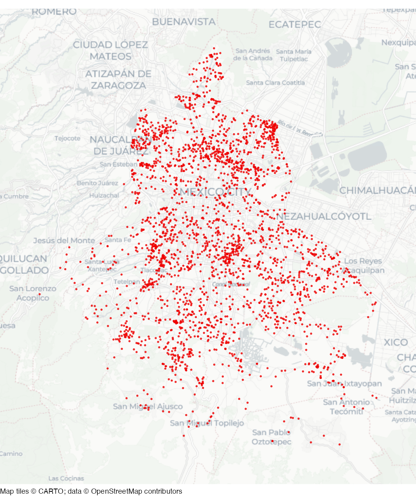

# Car jackings in Mexico City

Dataset of car jackings (*"robo de vehiculo de servicio particular con
violencia"*) in Mexico City in 2019.

## Usage

``` r
cdmx_car_jacking
```

## Format

Simple features (SF) object containing 2,811 rows and 4 columns:

- fecha_hechos:

  Date and time of the offence

- longitud:

  Longitude

- latitud:

  Latitude

- geometry:

  SF point geometry

This dataset is also available as a stand-alone file in geopackage
format at
<https://mpjashby.github.io/crimemappingdata/cdmx_car_jacking.gpkg>.

Licence: Creative Commons Attribution
<https://creativecommons.org/licenses/by/4.0/>

## Source

Mexico City Attorney General’s Office

## Map


