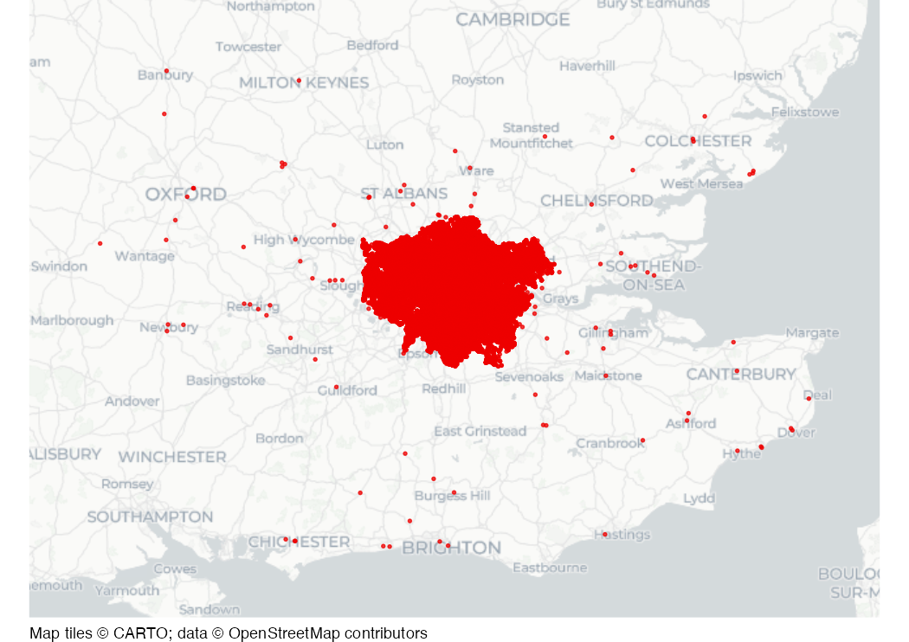

# Crimes in London

Dataset of crimes recorded by police in London in 2022. Includes a small
number of crimes that occurred outside London, to provide an opportunity
to remove rows from datasets based on location.

## Usage

``` r
london_crimes
```

## Format

A data frame containing 849,409 rows and 5 columns:

- month:

  Month in which crime occurred

- type:

  Offence type

- location_type:

  Location type

- longitude:

  Longitude

- latitude:

  Latitude

This dataset is also available as a stand-alone file in zipped CSV
format at
<https://mpjashby.github.io/crimemappingdata/london_crimes.zip>.

Licence: Open Government Licence
<https://www.nationalarchives.gov.uk/doc/open-government-licence/>

## Source

Home Office <https://data.police.uk/>

## Map


