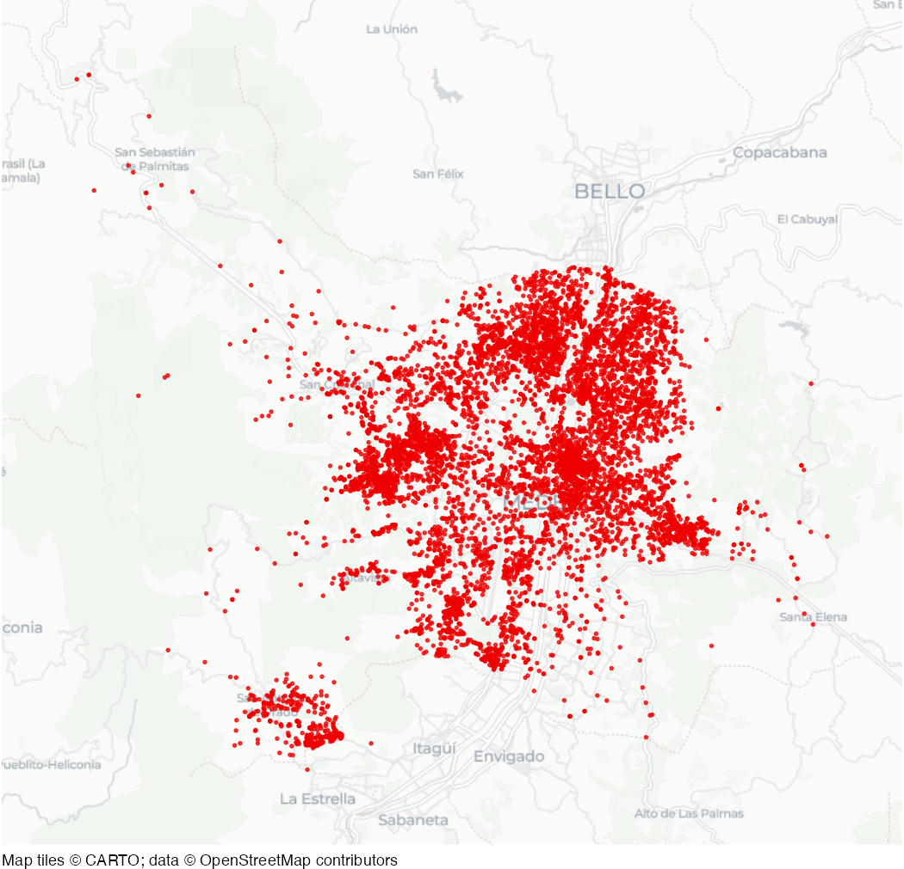

# Medellin homicides

Dataset of homicides in Medellin, Colombia, from 2010 to 2019.

## Usage

``` r
medellin_homicides
```

## Format

A data frame of 9,360 rows and 6 columns:

- fecha_hecho:

  Date-time of the incident

- longitud:

  Longitude

- latitud:

  Latitude

- sexo:

  Sex of victim

- edad:

  Age of victim in years

- modalidad:

  Method of homicide

This dataset is also available as a stand-alone file in CSV format at
<https://mpjashby.github.io/crimemappingdata/medellin_homicides.csv>.
Note that the CSV file uses semi colons as column delimiters and commas
as decimal separators in numbers. This file can be read with functions
such as
[`readr::read_csv2()`](https://readr.tidyverse.org/reference/read_delim.html).

Licence: Creative Commons Attribution Share-Alike
<https://opendefinition.org/licenses/cc-by-sa/>

## Map


