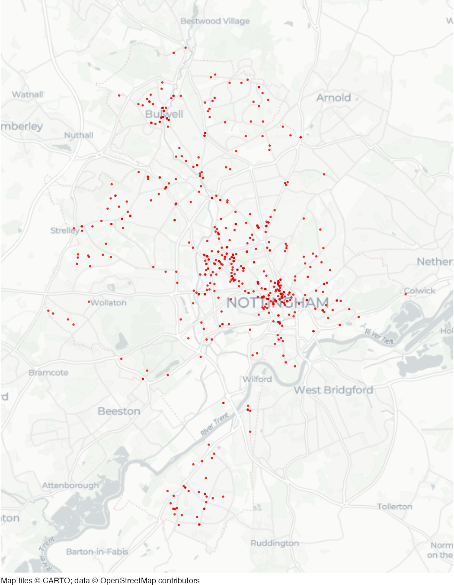

# Robberies in Nottingham

Dataset of robberies (both personal and commercial) recorded by police
in Nottingham, England, in 2022.

## Usage

``` r
nottingham_robbery
```

## Format

A data frame of 555 rows and 5 columns:

- month:

  Date of the first day of the month of the incident

- longitude:

  Longitude

- latitude:

  Latitude

- location:

  Street name or point-of-interest category

- lsoa_code:

  Government Statistical Service code for the Lower Layer Super Output
  Area in which the incident occurred

This dataset is also available as a stand-alone file in gzipped CSV
format at
<https://mpjashby.github.io/crimemappingdata/nottingham_robbery.csv.gz>.

Licence: Open Government Licence

## Source

Home Office

## Map


