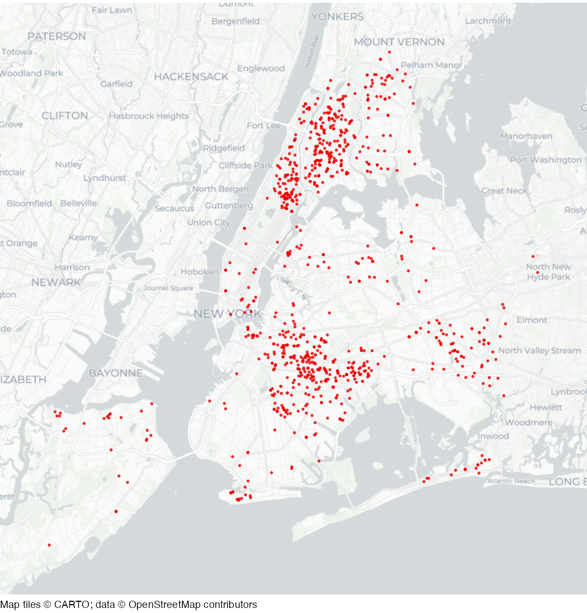

# Shootings in New York City in 2019

Dataset of shootings in New York City recorded by the New York City
Police Department (NYPD) in 2019.

## Usage

``` r
nyc_shootings
```

## Format

A data frame with 967 rows and six columns:

- incident_key:

  Numeric reference number for each incident

- boro:

  Borough name

- occur_date:

  Date offence occurred

- murder:

  Whether the shooting was fatal or not (logical)

- longitude:

  Longitude

- latitude:

  Latitude

This dataset is also available as a stand-alone file in CSV format at
<https://mpjashby.github.io/crimemappingdata/nyc_shootings.csv>.

Licence: NYC Open Data Law

## Source

New York City Police Department
<https://data.cityofnewyork.us/Public-Safety/NYPD-Shooting-Incident-Data-Historic-/833y-fsy8>

## Map


