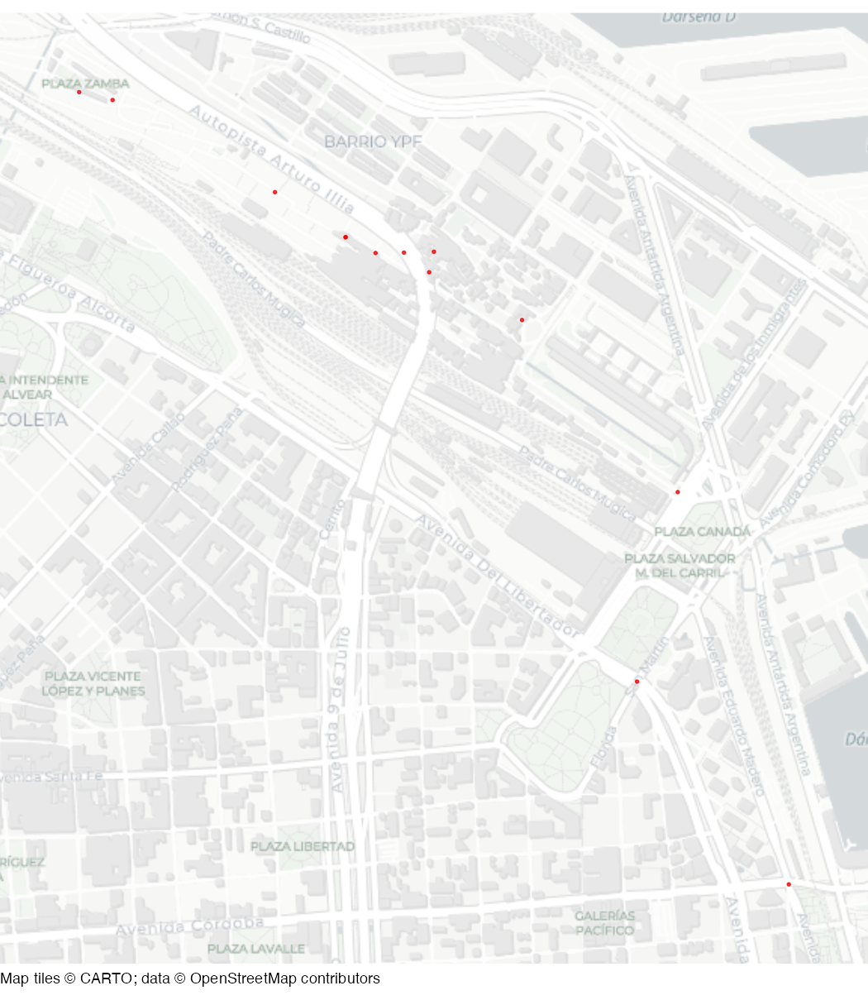

# Retiro homicides in 2023

Homicides in the Retiro neighbourhood of Buenos Aires in 2023.

## Usage

``` r
retiro_homicides
```

## Format

A data frame with 13 rows and 4 columns.

- id_mapa:

  Source record identifier

- fecha:

  Recorded event date and time (to the nearest hour)

- longitud:

  Longitude in decimal degrees

- latitud:

  Latitude in decimal degrees

A version of this dataset is available as a stand-alone file at
<https://mpjashby.github.io/crimemappingdata/retiro_homicides.csv>. Note
that while this is a Spanish-language dataset the file uses commas as
delimiters.

Licence: Creative Commons Attribution

## Source

Direccion General de Estadistica Criminal y Mapa del Delito, City of
Buenos Aires <https://data.buenosaires.gob.ar/dataset/delitos>.

## Map


