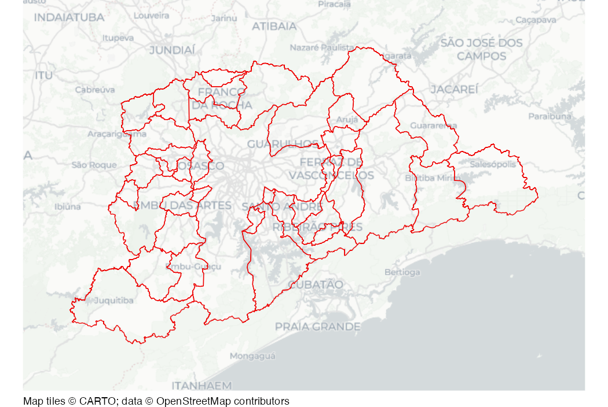

# Sao Paolo municipality boundaries

Dataset of municipality boundaries in the immediate region of Sao Paulo,
2010.

## Usage

``` r
sao_paulo_muni
```

## Format

A data frame containing 60 rows and 3 columns:

- code_muni:

  Statistical code for municipality

- name_muni:

  Municipality name

- geom:

  Feature geometry

A version of this dataset is also available as a stand-alone file at
<https://mpjashby.github.io/crimemappingdata/sao_paulo_muni.geojson>.

Licence: public domain

## Source

Institute for Applied Economic Research

## Map


