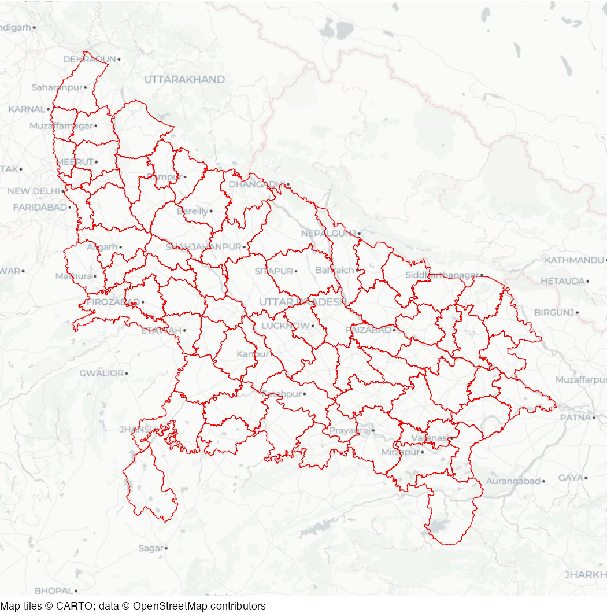

# Districts of Uttar Pradesh

Spatial dataset of the boundaries of administrative districts in the
Indian state of uttar Pradesh.

## Usage

``` r
uttar_pradesh_districts
```

## Format

Simple features (SF) object containing 75 rows and 3 columns:

- state:

  State name

- district_name:

  District name

- geometry:

  SF geometry representation of the district boundary

This dataset is also available as a stand-alone file in geopackage
format at
<https://mpjashby.github.io/crimemappingdata/uttar_pradesh_districts.gpkg>.

Licence: MIT

## Source

Hindustan Times <https://github.com/HindustanTimesLabs/shapefiles>

## Map


