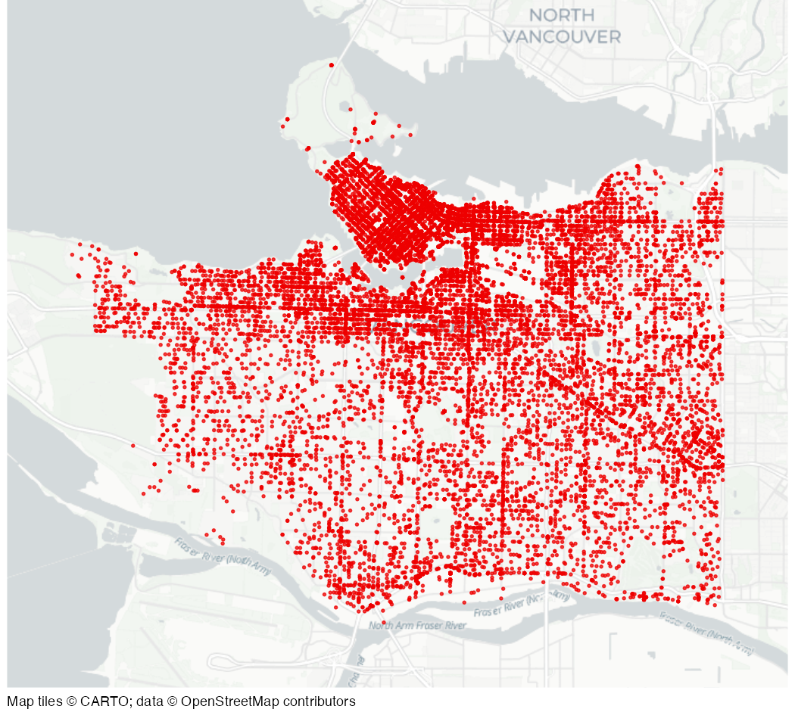

# Thefts in Vancouver in 2020

Dataset of 21,918 thefts in the City of Vancouver in 2020.

## Usage

``` r
vancouver_thefts
```

## Format

A data frame with 21,918 rows and 10 columns:

- TYPE:

  The type of theft

- YEAR:

  The year (2020)

- MONTH:

  A month as a number

- DAY:

  A day of the month as a number

- HOUR:

  A hour as a number

- MINUTE:

  A minute past the hour as a number

- HUNDRED_BLOCK:

  An address, anonymised to the nearest 100 block

- NEIGHBOURHOOD:

  A neighbourhood name

- X:

  X co-ordinate in the UTM zone 10 north CRS (EPSG:32610)

- Y:

  Y co-ordinate in the UTM zone 10 north CRS (EPSG:32610)

This dataset is also available as a stand-alone file in gzipped CSV
format at
<https://mpjashby.github.io/crimemappingdata/vancouver_thefts.csv.gz>.

## Source

Vancouver Police Department <https://geodash.vpd.ca/opendata/>

## Map


